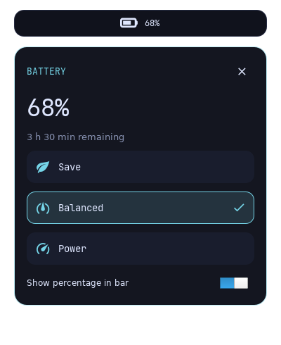

# NOCTURNE — NixOS 26.05 / Hyprland 0.57.1

濃紺・青紫・シアンのHyprland環境。NixOSの土台は26.05のまま、Hyprlandは公式リリースv0.57.1とその依存リビジョンに固定しています。

## 追加機能とアプリ

- タッチパッドの3本指左右スワイプでワークスペースを切り替えます。Hyprland 0.57.1の`hl.gesture`を使用します。
- 壁紙はswww 0.11.2。UWSMセッションの開始時だけdaemonを起動し、終了時に止めます。
- Super+W、またはアプリ一覧の「Wallpaper」でサムネイル付きの3列グリッドを開きます。`~/Pictures/Wallpapers`にPNG/JPEG/WebP/GIF/BMPを置き、文字入力で検索、矢印キーで移動、Enterで選択、Escapeでキャンセルします。サブフォルダも対象です。壁紙メニューだけWayland対応rofiを使い、通常のアプリ検索は従来どおりです。
- サムネイルは480×270に縮小して`~/.cache/nocturne/wallpaper-thumbnails/`へ保存します（`XDG_CACHE_HOME`設定時はそちら）。変更した画像は自動で作り直し、GIFは先頭フレームを表示します。適用時は元画像・元GIFをswwwへ渡します。プレビューを作れない画像は代替画像で表示します。
- 選択を`~/.local/state/nocturne/wallpaper.json`へ保存し、次のログイン時に復元します。モニター追加・再接続・解像度やスケール変更時も、`nocturne-wallpaper-watch.service`が約2秒ごとに検出して対象画面へ再適用します（`XDG_STATE_HOME`設定時はそちら）。元画像を移動・削除するとNixで指定した既定画像へ戻ります。
- GCC、Codex CLI、VS Code、Google Chrome、Discord、オリジナルのNeofetch 7.1.0を導入します。Super+BでChromeを開きます。
- ターミナル用にNeofetch・htop・cmatrix・cavaを導入します。Kittyでそれぞれ`neofetch`・`htop`・`cmatrix`・`cava`を実行してください。cavaは音楽などの再生中に音声を可視化します。
- アプリ一覧の「ChatGPT」は公式サイトをChromeの独立ウィンドウで開きます。Codexはターミナルで`codex`を実行します。
- 起動時はReGreetのGUIログイン画面。ロック画面に合わせたぼかし壁紙・大きな中央時計・ユーザー名・シンプルな入力欄を表示し、ログイン後はUWSM経由でHyprlandを起動します。
- Quickshell 0.3.2のSpotifyカードを右下に表示します。Super+Mで表示切替、QuickshellバーのバッテリーをクリックするとSave / Balanced / Powerを選べます。

VS Codeは公式Marketplaceの拡張機能を使いやすいため採用しました。エディタ本体はNixで更新し、テレメトリはオフにしています。非自由ライセンスの許可はVS Code・Chrome・Spotify・Discordの4パッケージに限定しています。

`neofetch`は現在のnixpkgsから削除されているため、上流の最終公開版を`flake.lock`で固定して独自パッケージ化しました。また現在のnixpkgsの`swww`は`awww`への別名なので、指定どおり元のswwwを使うため公式v0.11.2を固定しています。

Codexの初回ログインだけ、本人の操作で行います。認証情報はNixファイルに書きません。

```bash
codex login
codex
```

## 動作中の0.57.1構成を更新

実機設定を入れてビルドしたフォルダを使います。今回の環境では`~/NixOS-Nocturne-0571`です。次を1行ずつ実行し、エラーがあれば止めます。

```bash
cd ~/NixOS-Nocturne-0571
git pull --ff-only
sudo nixos-rebuild test --flake path:.#nocturne
hyprctl reload
systemctl --user restart nocturne-wallpaper.service
```

3本指スワイプ、Super+W、`swww query`、`codex --version`、`code --version`、`google-chrome-stable --version`、`neofetch --version`を確認したら永続適用します。

```bash
sudo nixos-rebuild switch --flake path:.#nocturne
```

初回はswwwのビルドやChrome/VS Codeのダウンロードに時間がかかる場合があります。`git pull`がローカル変更との競合で止まったら、その変更を確認してから統合してください。

## 再現性と編集先

| 編集先 | 管理するもの |
|---|---|
| `modules/nixos/login.nix` | GUIログイン・キーボード・UWSMセッション |
| `lib/battery-tools.nix` / `home/scripts/battery.py` | タスクバーのバッテリー表示・％表示設定の保存 |
| `lib/login-style.nix` | ログイン画面のGTK CSS（色と壁紙は`theme.nix`参照） |
| `home/programs/development.nix` | GCC・Codex・VS Code・Chrome・Discord・Neofetch、エディタ設定 |
| `home/programs/spotify.nix` | Spotify・Spicetify・テーマ・拡張機能 |
| `home/programs/spicetify/Nocturne/` | Spotify用の追加CSS |
| `home/desktop/wallpaper.nix` | swwwサービス、壁紙メニュー登録 |
| `home/desktop/quickshell/` | Spotifyカード・電源モードメニューのQML |
| `home/desktop/quickshell.nix` | ウィジェットのインストール・UWSM連携 |
| `modules/nixos/power.nix` | 省電力サービスと競合回避 |
| `lib/wallpaper-menu-theme.nix` | サムネイル選択画面の配置・配色 |
| `home/desktop/hypr/input.lua` | 3本指ジェスチャー |
| `theme.nix` | 再現する既定壁紙、色、フォント |
| `assets/` | Gitで管理する既定壁紙の画像 |
| `flake.lock` | 正確なソースリビジョンとハッシュ |

アプリの追加・削除は`.nix`に書いてrebuildします。`nix-env`や`npm install -g`による手動インストールは不要です。更新は`flake.lock`を意図的に更新したときだけ行います。壁紙UIでの選択と各サービスへのログインはユーザーごとの実行時の状態です。別PCでも同じ既定壁紙にしたい場合は、画像を`assets/`へ追加し、`theme.nix`の`wallpaper`を変更してGitへ保存します。実機のディスク設定とユーザー名は従来どおり`hosts/nixos/base/`と`user.nix`で管理します。

## 修正の内容

- `flake.lock`を同梱し、Hyprland v0.57.1・XDPH・Mesaを上流の同じ依存集合から取得します。Home Managerはrelease-26.05です。
- Kittyもその依存集合から取得し、Home Managerがインストールする実体とSuper+Enterが呼ぶ実体を一致させます。新しいMesaを古いlibcのKittyへ動的ロードする組み合わせを避けます。
- 配色やモニタはNixの値から`lib.generators.toLua`で生成します。Luaの文字列へNixの式を手入力する必要はありません。
- グラデーションはLuaのテーブル、タッチパッドは`tap_to_click`を使い、削除された`dwindle.pseudotile`は設定しません。
- キーバインドを装飾より先に登録します。ターミナル等のコマンドはNix storeの絶対パスで指定します。
- 生成ファイルはビルド時に`luac -p`と、採用したHyprland自身の`--verify-config`を通します。設定キーやdispatcherが無効なら適用前のビルドで停止します。
- UWSMの起動入口を`hyprland.desktop`に揃え、バー・壁紙・idle・通知・polkitを`wayland-session@hyprland.desktop.target`へ結び付けます。別DEでの二重起動を避けます。
- Home Managerのセッション変数を`uwsm/env`から読み込みます。
- dconfを無効にしません。HMの設定適用だけは既存バスを引き継がず、標準の`dbus-run-session`経路を利用します。古いユーザーセッションのサービス検索パスへの依存を避け、GTKのフォント・アイコン・カーソル・ダークモードを反映します。

## 管理するファイル

| ファイル | 用途 |
|---|---|
| `user.nix` | ログイン名、モニタ、キーボード、Home Manager初期バージョン |
| `theme.nix` | 配色、フォント、壁紙、角丸 |
| `flake.nix` / `flake.lock` | パッケージと固定リビジョン |
| `lib/desktop-packages.nix` | Hyprland、XDPH、Mesa、Waybar等の取得元 |
| `home/desktop/hypr/` | メインLua、外観、入力、キーバインド |
| `lib/hyprland-config.nix` | 型付きLua生成とHyprlandによる実検証 |
| `home/desktop/dconf.nix` | 設定適用時のD-Busライフサイクル |
| `hosts/nixos/base/` | 実機の既存NixOS設定。公開前に機密を確認 |
| `checks/` | モジュール連携評価、D-Bus設定反映のテスト |

## 既存のNOCTURNEから更新

手元には修正途中のファイルがあるため、既存フォルダを残し、新しいフォルダへcloneする方法を推奨します。
既存の`~/NixOS-Nocturne`内で、次を順に実行します。

```bash
git clone https://github.com/hirochin0/NixOS-Nocturne.git ../NixOS-Nocturne-0571
cp user.nix ../NixOS-Nocturne-0571/user.nix
cp -a hosts/nixos/base/. ../NixOS-Nocturne-0571/hosts/nixos/base/
cd ../NixOS-Nocturne-0571
```

新しいcloneには、現在のユーザー・モニタ設定と実機のbase設定だけを取り込みます。
古いリポジトリはそのままバックアップとして残ります。`NixOS-Nocturne-0571`が既にある場合、別の新しいフォルダ名を使ってください。

この後、下記の「ビルドと確認」を進めます。`user.nix`とbase以外に独自の設定がある場合は、元フォルダと差分を確認して移してください。

## 初回導入の準備

NixOSをインストール済みの環境が対象です。UEFI、Windowsとのデュアルブート、ディスク、カーネル等は既存設定を引き継ぎます。

1. リポジトリをcloneし、そのディレクトリへ移動します。
2. 既存`/etc/nixos`全体を別の場所へバックアップします。
3. `/etc/nixos/.`を`hosts/nixos/base/`へディレクトリ構造ごとコピーします。既存のconfiguration.nixで案内用throwを置き換えます。
4. `user.nix`の`name`を現在のログイン名へ変更します。このリポジトリの既定値は`hiroto`です。
5. 既存利用者はHome ManagerのstateVersionを維持します。system.stateVersionも元の値を変えません。
6. 元設定のHome Manager、Hyprland、通知、PulseAudio単体などの重複を整理します。`user.nix`の`enableGreetd = true;`でNocturneのGUIログインを使用します。このときSDDM/GDM/LightDM/lyと自動ログインは無効になります。元のログインマネージャーを使う場合だけ`false`にします。

既存設定がFlakeのinputsやspecialArgsに依存する場合は、その依存も統合する必要があります。公開リポジトリには実機のbase設定が含まれていないため、こちらでは実機のシステム全体は検証できません。

## ビルドと確認

TTYまたは現在のKDE/GNOMEから、リポジトリ内で実行します。初回だけ、公式Hyprlandバイナリキャッシュの設定も読み込むためrootでビルドします。

```bash
sudo nix --extra-experimental-features 'nix-command flakes' --accept-flake-config build path:.#checks.x86_64-linux.hyprland-config --out-link config-result
sudo nix --extra-experimental-features 'nix-command flakes' --accept-flake-config build path:.#checks.x86_64-linux.dconf-activation --out-link dconf-result
sudo nix --extra-experimental-features 'nix-command flakes' --accept-flake-config build path:.#nixosConfigurations.nocturne.config.system.build.toplevel
sudo ./result/bin/switch-to-configuration test
```

最後まで成功したら作業を保存し、ログアウトして`Hyprland (uwsm-managed)`を選びます。既存の古いHyprlandプロセスへ`reload`するだけでは、パッケージやUWSM環境は更新されません。

TTYから直接起動する場合は、他のグラフィカルセッションを終了してから次を実行します。

```bash
uwsm start -e -D Hyprland hyprland.desktop
```

`uwsm start hyprland-uwsm.desktop`は使いません。そのdesktop entry自体がUWSMを起動するラッパーだからです。

ログイン後に確認します。

```bash
Hyprland --version
hyprctl configerrors
systemctl --user status wayland-session@hyprland.desktop.target --no-pager
systemctl --user --failed
systemctl status home-manager-hiroto.service --no-pager
dconf read /org/gnome/desktop/interface/color-scheme
```

`configerrors`が空で、Super+Enter、Super+D、バー、壁紙、音声、Wi-Fi、日本語入力、ロックと解除を確認できたら永続適用します。

```bash
sudo nixos-rebuild switch --flake path:.#nocturne
```

`test`はブートの既定を変更しませんが、Home Managerのホーム内ファイルは変更されます。バックアップは残してください。

## 操作

| キー | 動作 |
|---|---|
| Super+Enter | Kitty |
| Super+D | アプリ検索 |
| Super+B / E | Google Chrome / Thunar |
| Super+W | 壁紙選択 |
| Super+M | Spotifyカードの表示切替 |
| Super+Q | ウィンドウを閉じる |
| Super+F / Space | 全画面 / フロート |
| Super+矢印 | フォーカス |
| Super+Shift+矢印 | ウィンドウ移動 |
| Super+1〜9 | ワークスペース |
| Super+Shift+1〜9 | 指定ワークスペースへ移動 |
| Super+左/右ドラッグ | 移動 / リサイズ |
| Super+L | ロック |
| Super+Shift+E | 電源メニュー |
| Print / Super+Shift+S | 範囲スクリーンショット |
| 明るさキー / Super+F5・F6 | 内蔵画面を5%ずつ暗く / 明るく |

Quickshellバーの太陽アイコンには内蔵画面の明るさ（%）を表示します。アイコン上で上スクロールすると明るく、下スクロールすると暗くなり、キー操作による変更も表示に反映されます。ThinkPadのF5/F6はFn Lockの状態によりFnとの同時押しが必要です。Super+F5/F6でも操作できます。

キー操作とバーは`lib/brightness.nix`の同じコマンドを使用し、`backlight`クラスを自動選択します。デバイス名を固定せず、キーボード照明は変更しません。最低値はハードウェアの1段階です。権限はNixOSのudevルールと`video`グループで管理するため、毎回sudoを使う必要はありません。外部HDMI/DisplayPortモニターの明るさは別途DDC/CI対応が必要です。

既存環境に初めて適用した際は、rebuild後に`sudo udevadm trigger --subsystem-match=backlight --action=add`を実行すると、接続済みバックライトにも権限を反映できます。以後の起動時は自動適用されます。

## NocturneのGUIログイン


プレビューはReGreetのデモモードで描画したものです。実際の認証は実機のPAMが担当します。

`user.nix`の`enableGreetd = true;`でgreetd + ReGreetを使用します。CageとReGreetはMesaと同じ固定パッケージ集合から導入します。認証にはgreetdのPAMを使用し、ユーザー名やパスワードをコードに埋め込みません。

- 大きな中央時計、`NOCTURNE / ユーザー名`、角丸のパスワード欄を中心にした、ロック画面風のデザインです。大きなカード枠は表示せず、再起動・電源オフは下部に小さく配置します。
- `theme.nix`の配色・壁紙を参照します。壁紙のぼかしはビルド時に静止画として生成し、動画やリアルタイムぼかしの常駐処理を追加しません。
- ログイン画面と認証プロンプトは英語で表示します。日本語キーボードは`user.keyboardLayout`から設定し、ログイン後のデスクトップの言語設定は維持します。
- セッション選択は`NOCTURNE (Hyprland)`のみです。内部では従来と同じ`uwsm start -e -D Hyprland hyprland.desktop`を使用し、Quickshellのsystemdターゲットを維持します。
- 初回はユーザーを選んで右側の矢印（Log in）、続けてパスワードを入力して矢印をクリックします。次回以降は記憶したユーザー・セッションでパスワード入力から始めます。Backでユーザーを選び直せます。Enterでも操作できます。
- SDDM/GDM/LightDM/lyとの同時起動と、自動ログインを無効化します。ロック画面（Hyprlock）の設定は別です。

レイアウトは`assets/regreet/lock-layout.patch`でReGreet 0.5.0のGTKテンプレートと表示状態だけを調整しています。PAM・greetd IPC・セッション開始処理は上流のままです。初回はカスタマイズ版ReGreetのコンパイルに時間がかかります。

ログイン方式の変更は、現在の作業を継続したまま次回起動へ適用できます。

```bash
cd ~/NixOS-Nocturne-0571
git pull --ff-only
sudo nixos-rebuild boot --flake path:.#nocturne
sudo reboot
```

`boot`が成功してから再起動してください。実機のディスク・ブート設定は`hosts/nixos/base/`のものを使用し、この変更では編集しません。

ログイン画面が表示されない場合はCtrl+Alt+F3（Fnキーが必要な機種は併用）でTTYへ移動し、ログインして`sudo nixos-rebuild switch --rollback`で以前の世代へ戻せます。ログは`sudo journalctl -b -u greetd --no-pager`と`/var/log/regreet/log`で確認できます。

## Spotifyウィジェットと電源モード

`spotify`を起動してログインすると、ネイティブ版Spotifyの曲情報をQuickshell標準MPRIS機能で取得します。カードはSpicetifyのテーマとは独立して動作します。ブラウザ版Spotifyはこのカードの対象外です。

### SpotifyとSpicetifyの管理

`home/programs/spotify.nix`でSpotify、Spicetify CLI、Marketplaceのソースを固定し、ユーザー所有のSpotifyコピーへ起動時に適用します。通常のSpotifyは重複してインストールしません。GUIとCLIはMesaと同じnixpkgsを使用します。Nixストアの権限変更や`sudo spicetify`は不要です。

1. rebuild前にSpotifyを完全に終了してください。
2. rebuild後、アプリ一覧のSpotify、または`spotify`で起動します。
3. 初回でSpotifyの設定が存在しない場合は、ログイン後にSpotifyを完全終了してもう一度起動してください。
4. Spotify内のMarketplaceからテーマ・拡張機能・スニペットを選べます。

初期テーマはNocturneです。その後の選択はユーザー側で管理し、通常のrebuildで上書きしません。Spotify・CLI・Marketplaceの固定ソースが更新されたときは、次回起動時にコピーを作り直して再適用します。再適用中のエラーは起動したターミナルに表示されます。

| 保存場所 | 内容 |
|---|---|
| `${XDG_DATA_HOME:-~/.local/share}/nocturne/spotify/` | 書き換え可能なSpotify本体・適用済みソースの記録 |
| `${XDG_CONFIG_HOME:-~/.config}/spicetify-nocturne/` | 編集可能なSpicetify設定・テーマ・Marketplace |
| `${XDG_CONFIG_HOME:-~/.config}/spotify/` | Spotifyのログインやユーザーデータ |

Marketplaceで選んだ内容は自動でGitには保存されません。別PCへ移行するときはSpotifyのユーザーデータ（Marketplaceが使うlocalStorageを含む）とSpicetify設定を別途バックアップしてください。ログイン情報はGitへ追加しないでください。

`spicetify --version`や`spicetify apply`は、この構成専用のラッパーから同じ設定を参照します。適用はSpotifyを終了してから行ってください。テーマを選び直す場合はMarketplaceを利用できます。

参照: [Marketplace公式](https://github.com/spicetify/marketplace)、[SpicetifyのCLI](https://spicetify.app/docs/cli/commands)。

### Spotifyカード

- ジャケット・曲名・アーティスト・再生時間、再生/停止・前/次・シャッフル・リピート・シークに対応。Spotifyが公開しない機能は無効表示にします。
- Spotifyを終了するとカードを隠します。一時停止中はカードを残し、時間更新タイマーを停止します。Super+Mで手動表示切替できます。
- カードは通常のウィンドウの下にあり、タイル配置の領域を予約しません。既定では接続中の全画面に表示し、接続・切断に自動で追従します。Spotifyカードだけを特定の画面へ表示する場合は`user.nix`の`musicWidgetOutput`で指定でき、指定画面が外れた場合は内蔵画面、なければ最初の接続画面へ戻します。
- 常時のシェルコマンド呼び出しや毎フレームの更新は使いません。メタデータはD-Busイベント、再生時間だけ表示中かつ再生中に1秒間隔で更新します。

### 電源モード

Quickshellバーの横向きバッテリーをクリックすると、Quickshellの電源メニューが開きます。選択中のモードにチェックが付き、Esc・外側クリック・閉じるボタンで閉じます。モードの説明文は表示しません。



- メニューに残量とUPowerの推定残り時間を表示します。充電中は満充電までの時間、満充電時はFully chargedを表示します。推定値が未取得の場合はEstimating…と表示します。各モードの架空の稼働時間は計算しません。
- Show percentage in barで、タスクバーの％表示をオン／オフできます。メニュー内の残量は常に確認できます。
- 設定は`${XDG_STATE_HOME:-~/.local/state}/nocturne/battery.json`へ保存し、次回ログイン後も維持します。変更はQuickshellバーにも反映されます。
- タスクバーのアイコンは横向きで、他の文字より少し大きく表示します。充電中は緑、残量低下時は黄／赤になります。

| 表示 | power-profiles-daemonのプロファイル |
|---|---|
| Save | power-saver |
| Balanced | balanced |
| Power | performance |

Powerはハードウェア/ドライバが対応する場合だけ選べます。実際に制御されるCPU・プラットフォーム設定はカーネルと機器の対応に従います。モード選択をAC接続やログインのたびに上書きする独自スクリプトは入れていません。

`modules/nixos/power.nix`でpower-profiles-daemonを有効にし、競合するTLP・auto-cpufreq・powertop自動調整を無効にします。`home/desktop/lock.nix`では5分でロック、6分で画面オフ。再生アプリ等のidle inhibitorが有効な場合は、それに従います。自動サスペンドは追加しません。電池の実測持続時間は、画面の明るさ・アプリ・ファームウェア・選択モードによって変わります。

更新後は以下を1行ずつ実行します。設定は`quickshell/nocturne/`にまとめ、サービスと操作コマンドは同じパスを明示します。別のQuickshell設定がある場合も、その設定を変更しません。

```bash
cd ~/NixOS-Nocturne-0571
git pull --ff-only
sudo nixos-rebuild switch --flake path:.#nocturne
hyprctl reload
systemctl --user restart nocturne-widgets.service hypridle.service
spotify
```

状態確認とログ:

```bash
powerprofilesctl get
powerprofilesctl list
systemctl status power-profiles-daemon.service --no-pager
journalctl --user -b -u nocturne-widgets.service -n 100 --no-pager
```

## Vim

`home/programs/vim.nix`でVimとプラグインを管理します。Nocturneの配色、行番号、マウス、永続Undoを設定済みです。通常はスペース4文字、Nixは2文字のインデントです。既存の`EDITOR=nano`はそのままです。

| プラグイン | 用途 |
|---|---|
| fzf.vim | ファイル・バッファ・全文検索（fzf/ripgrep） |
| vim-fugitive | Gitの状態確認・差分・コミット操作 |
| vim-gitgutter | 変更した行を左端に表示 |
| vim-commentary | コメントの切替 |
| vim-surround | 括弧・引用符の追加と変更 |
| vim-nix | Nixの構文・インデント |

更新・適用後に`vim file.nix`で起動します。`i`で入力、`Esc`で通常モード、`:wq`で保存して終了、`:q!`で保存せず終了します。

以下は通常モードで順に押します。`Space`はスペースキーです。

| キー | 操作 |
|---|---|
| `Space f f` | カレントディレクトリのファイルを検索 |
| `Space f g` → 検索語 → Enter | ファイルの内容を検索 |
| `Space f b` | 開いているバッファを検索 |
| `Space g s` | Gitの状態を表示 |
| `Space g d` | 現在のファイルのGit差分を分割表示 |
| `Space e` | ディレクトリを表示 |
| `Space Space` | 検索ハイライトを消す |
| `gcc` | 現在行のコメントを切替（ビジュアル選択後は`gc`） |
| `ysiw"` | 現在の単語を二重引用符で囲む |
| `cs"'` / `ds"` | 二重引用符を単引用符に変更 / 削除 |

プラグインはNixで導入するため、`:PlugInstall`等の操作は不要です。設定変更はこのモジュールを編集してコミットし、`nixos-rebuild switch --flake path:.#nocturne`で適用します。端末のVim設定は`nix build path:.#checks.x86_64-linux.vim`で検証できます。

## 検証範囲

詳細は`docs/VALIDATION.md`を参照してください。GPU・画面・実機のログイン・Windowsとの起動切替は対象マシンで確認が必要です。

## Git管理

`.gitignore`はbaseのハードウェア設定等を意図的に除外しています。Git Flakeには追跡済みファイルしか含まれないため、ローカル全体の検証では`path:.`を使います。

公開するのは機密がないと確認したファイルだけにしてください。`flake.lock`は生成済みのものを保存し、更新時だけ意図的に変更します。

## ORBIT アプリショートカット

各モニターの左上（左20px、上60px）の月画像をクリックすると、最大21個のアプリがツリー状に展開します。月からTerminal・Chrome・Filesへ最初の3本の枝が伸び、そこから次のアプリへ木のように枝分かれします。背景パネルは表示しません。月タイル96px、アプリタイル62px、内部アイコン32pxです。

細いシアンの線は親アプリから子アプリにつなぎ、幹に近い線を太く、先の線を細くし、幹→枝→小枝の順に時間差で展開します。各接続は適度な斜めの角度を持つ直線です。各アプリは親の位置から直線に沿って弾むように伸び、閉じるときは先端から戻ります。画像の傾き・押し込み、アプリのホバー拡大も維持しています。通常のウィンドウが手前になり、空白部分はクリックを下へ通します。画像の再クリック、Esc、アプリの起動で閉じます。22件以上は21件ずつページを切り替えます。

初期構成はTerminal・Chrome・Files・Code・Discord・Spotify・Firefox・Network・Bluetooth・ChatGPTの10件です。以前の初期6件、または初期の1本幹ツリーをそのまま使っている場合は、次回適用時に画像や他の設定を保持して新しい10件・3本幹へ移行します。独自のアプリ一覧やシンボリックリンクの設定は上書きしません。

初期画像は`home/desktop/quickshell/launcher.svg`、初期アプリは同ディレクトリの`launcher-defaults.json`でNix管理します。初回適用時に`~/.config/nocturne/launcher.json`を作成します。このファイルはユーザーが編集でき、再構築でも上書きされません。編集を保存すると自動で読み直します。

例えば画像を`~/Pictures/launcher.png`に保存して、JSONを以下のように編集します（`~`は展開されないため、絶対パスを使います）。画像は中央を正方形に切り取り、角を丸めます。画像を読み込めない場合は初期画像に戻ります。

```json
{
  "image": "file:///home/hiroto/Pictures/launcher.png",
  "apps": [
    {"name": "Terminal", "desktopId": "kitty"},
    {"name": "Chrome", "desktopId": "google-chrome"},
    {"name": "Code", "desktopId": "code"}
  ]
}
```

`apps`に行を追加するとショートカットを追加できます。`desktopId`はインストールしたアプリの`.desktop`ファイル名（拡張子は省略可）です。`~/.local/share/applications`、`/etc/profiles/per-user/hiroto/share/applications`、`/run/current-system/sw/share/applications`等で確認できます。未インストールのアプリは起動しません。JSONの書式が壊れた場合は直前の有効な一覧を保持します。画像ファイル自体を置き換えた場合は、別名にしてJSONのパスを変更すると確実に再読み込みできます。

初期設定へ戻すには`~/.config/nocturne/launcher.json`を削除し、再度`nixos-rebuild switch --flake path:.#nocturne`を実行します。更新後は`systemctl --user restart nocturne-widgets.service`でウィジェットを再起動します。


## Quickshellタスクバー

タスクバー全体を`nocturne-widgets.service`が描画し、Waybarは無効化しています。全モニターの上端に表示し、通常のウィンドウがバーに重ならないよう領域を確保します。

左はランチャーとワークスペース（1〜5に加え、存在する追加ワークスペース）、中央は時計、右はネットワーク・音量・明るさ・横向きバッテリー・トレイ・電源操作です。時計のホバーでカレンダー、ネットワークのクリックで接続設定、音量のクリックでミキサー、右クリックでミュート、スクロールで音量や明るさを変更できます。バーの高さは46pxです。日付・時計は画面中央に固定し、左右の項目数によって位置が変わりません。

**開いているアプリ一覧は時計の右側、音量・電源などの操作部の左側**に表示します。ウィンドウごとに1個のアイコンを並べ、ホバーするとタイトルとワークスペース名を表示します。クリックすると、そのワークスペースを開いてウィンドウへフォーカスします。同じアプリの別ウィンドウも個別に選択できます。全モニター・全ワークスペースのウィンドウが対象です。収まらない場合はアイコン上のホイール／トラックパッドで横スクロールできます。選択中のウィンドウは下線で示します。

外部CLIの状態取得はバックグラウンドで2秒ごとに行い、実行中の取得を重複させません。ウィンドウ一覧・ワークスペース・バッテリー・トレイはQuickshellのサービスに追従します。アプリのアイコンはデスクトップエントリーとPapirusから取得します。QtのアイコンテーマもPapirus-Darkに固定し、解決できない場合は同梱の汎用アイコンを表示します。紫と黒の欠損テクスチャは表示しません。

主な管理元は`home/desktop/quickshell/Taskbar.qml`、`BarContent.qml`、`BarButton.qml`です。外部コマンドと状態取得は`lib/bar-tools.nix`と`home/scripts/bar.py`で管理します。

更新・移行:

```bash
cd ~/NixOS-Nocturne-0571
git pull --ff-only
sudo nixos-rebuild switch --flake path:.#nocturne
systemctl --user stop waybar.service 2>/dev/null || true
systemctl --user restart nocturne-widgets.service
```

アプリ一覧は参考画像に合わせた28pxのカラーアイコン列です。通常時の各ボタン背景は透明とし、選択中のアプリとホバーにだけ背景を付けます。

アイコン参照は実際のXDGデータディレクトリ、Nixのユーザープロファイル、Flatpakのエクスポート先を起動時と60秒ごとに読み取ります。desktopファイルの`Icon`・`StartupWMClass`・IDとウィンドウのアプリIDを照合し、ユーザーが上書きしたdesktopファイルを優先します。取得候補が読み込めなかった場合は次の候補へ進み、情報が後から読み込まれた場合も再取得します。

ChatGPTのChromeアプリウィンドウ（`chrome-chatgpt.com__-Default`）は`chatgpt.desktop`のStartupWMClassで対応付けます。このdesktopファイルで指定している画像はChromeのアイコンです。アプリ本来の画像（hicolor/pixmaps）を優先し、Papirusは元画像が見つからない場合に使います。

Hyprlandのウィンドウ一覧は`HyprlandToplevel`として扱い、`lastIpcObject.class`からアプリを特定します。空のアプリIDはdesktopエントリーへ一致させません。クリック時はウィンドウアドレスを指定したHyprland dispatchを優先し、対象ウィンドウとワークスペースへ直接フォーカスします。アドレスがまだない新規ウィンドウだけ、workspace移動とWaylandハンドルのactivateへフォールバックします。

## Liquid Glass風デスクトップ時計

デスクトップの中央、画面上端から約37％の位置に大きな24時間表示の時計を配置します。通常のアプリウィンドウが時計より手前になります。Nunitoの丸い太字、壁紙を取り込んだ数字のマスク、半透明グラデーションと縁の光を組み合わせたガラス風の描画です。デスクトップの他アプリ画面をキャプチャする仕組みではありません。

時計の周囲にカーソルを近づけると、水滴の表面が引かれるように、数字の近い輪郭だけがカーソルへわずかに伸びます。細かいメッシュを局所的に変形させ、離れた輪郭はほぼその場に保ちます。カーソルを離すとばねの動きで復帰します。壁紙の反射も少しずらして屈折感を付けています。壁紙ツールで保存する`~/.local/state/nocturne/wallpaper.json`を監視し、画像変更にも追従します。

上に英語の日付、下に小さな英語の一言を表示します。一言は内蔵の短いオリジナル文から日付で選び、同じ日には再起動しても同じ文を表示します。ネット接続は不要です。`ClockLogic.js`の`sayings`配列を編集すると文章を追加できます。

時計と月のランチャーは接続中の全モニターに表示し、後から接続した画面にも自動で追加します。`user.nix`の`musicWidgetOutput`はSpotifyカードだけに適用されます。位置・サイズは`ClockWindow.qml`、時計と動きは`GlassClock.qml`・`GlassDigit.qml`・`droplet.vert`で管理します。シェーダーはNixビルド時にQuickshellと同じQtの`qsb`で生成します。ソフトウェア描画環境では、ガラスのマスクを省略した読みやすい文字表示へ切り替わります。

タスクバーもNunitoの太字とカプセル形へ変更しました。日付の中央固定、アプリ一覧と操作部の順序を保ち、左端のNixロゴだけ32pxに拡大しています。字体は`BarButton.qml`、全体のスタイルは`BarContent.qml`で調整できます。


ORBITの各アプリには`"parent": 0`のように親を指定できます。番号はページ内の0〜20のアプリ番号、`-1`は月です。親は必ず自分より前の番号にします。省略時は初期の分岐構成を使います。ノード位置と既定の親は`BranchLogic.js`で調整できます。

## Steamとゲーム

`modules/nixos/gaming.nix`でSteamを有効にします。SteamはデスクトップのMesaと同じパッケージ集合を使い、32bitグラフィックも同じMesaへ揃えます。NixOSのSteamモジュールで32bit音声とSteam対応デバイスのudev設定も有効になります。

更新・適用後、ランチャーでSteamを検索するか、端末で`steam`を実行してログインしてください。ライブラリからゲームをインストールして起動できます。Windows用ゲームでは、必要に応じてゲームの「プロパティ」→「互換性」→「特定のSteam Play互換ツールの使用を強制する」でSteamが提供するProton（例: Proton Experimental）を選びます。

```bash
cd ~/NixOS-Nocturne-0571
git pull --ff-only
sudo nixos-rebuild switch --flake path:.#nocturne
steam
```

デスクトップ上のゲームプレイを対象とし、ゲームのインストール先はSteamの「設定」→「ストレージ」で指定します。Steam Remote Play・ローカル転送・専用サーバー用のファイアウォール開放は標準では有効にしていません。
