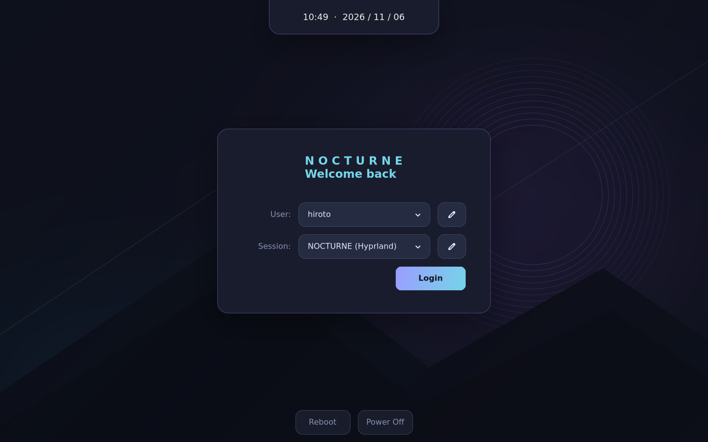

# NOCTURNE — NixOS 26.05 / Hyprland 0.57.1

濃紺・青紫・シアンのHyprland環境。NixOSの土台は26.05のまま、Hyprlandは公式リリースv0.57.1とその依存リビジョンに固定しています。

## 追加機能とアプリ

- タッチパッドの3本指左右スワイプでワークスペースを切り替えます。Hyprland 0.57.1の`hl.gesture`を使用します。
- 壁紙はswww 0.11.2。UWSMセッションの開始時だけdaemonを起動し、終了時に止めます。
- Super+W、またはアプリ一覧の「Wallpaper」でサムネイル付きの3列グリッドを開きます。`~/Pictures/Wallpapers`にPNG/JPEG/WebP/GIF/BMPを置き、文字入力で検索、矢印キーで移動、Enterで選択、Escapeでキャンセルします。サブフォルダも対象です。壁紙メニューだけWayland対応rofiを使い、通常のアプリ検索は従来どおりです。
- サムネイルは480×270に縮小して`~/.cache/nocturne/wallpaper-thumbnails/`へ保存します（`XDG_CACHE_HOME`設定時はそちら）。変更した画像は自動で作り直し、GIFは先頭フレームを表示します。適用時は元画像・元GIFをswwwへ渡します。プレビューを作れない画像は代替画像で表示します。
- 選択を`~/.local/state/nocturne/wallpaper.json`へ保存し、次のログイン時に復元します（`XDG_STATE_HOME`設定時はそちら）。元画像を移動・削除するとNixで指定した既定画像へ戻ります。
- Codex CLI、VS Code、Google Chrome、Discord、オリジナルのNeofetch 7.1.0を導入します。Super+BでChromeを開きます。
- ターミナル用にNeofetch・htop・cmatrix・cavaを導入します。Kittyでそれぞれ`neofetch`・`htop`・`cmatrix`・`cava`を実行してください。cavaは音楽などの再生中に音声を可視化します。
- アプリ一覧の「ChatGPT」は公式サイトをChromeの独立ウィンドウで開きます。Codexはターミナルで`codex`を実行します。
- 起動時はReGreetのGUIログイン画面。Nocturneの壁紙・濃紺カード・青紫からシアンへのログインボタン・時計を表示し、ログイン後はUWSM経由でHyprlandを起動します。
- Quickshell 0.3.2のSpotifyカードを右下に表示します。Super+Mで表示切替、WaybarのバッテリーをクリックするとSave / Balanced / Powerを選べます。

VS Codeは公式Marketplaceの拡張機能を使いやすいため採用しました。エディタ本体はNixで更新し、テレメトリはオフにしています。非自由ライセンスの許可はVS Code・Chrome・Spotify・Discordの4パッケージに限定しています。

`neofetch`は現在のnixpkgsから削除されているため、上流の最終公開版を`flake.lock`で固定して独自パッケージ化しました。また現在のnixpkgsの`swww`は`awww`への別名なので、指定どおり元のswwwを使うため公式v0.11.2を固定しています。

Codexの初回ログインだけ、本人の操作で行います。認証情報はNixファイルに書きません。

```bash
codex login
codex
```

## 動作中の0.57.1構成を更新

実機設定を入れてビルドしたフォルダを使います。今回の環境では`~/NixOS-Nocturne-0571`です。次を1行ずつ実行し、エラーがあれば止めます。

```bash
cd ~/NixOS-Nocturne-0571
git pull --ff-only
sudo nixos-rebuild test --flake path:.#nocturne
hyprctl reload
systemctl --user restart nocturne-wallpaper.service
```

3本指スワイプ、Super+W、`swww query`、`codex --version`、`code --version`、`google-chrome-stable --version`、`neofetch --version`を確認したら永続適用します。

```bash
sudo nixos-rebuild switch --flake path:.#nocturne
```

初回はswwwのビルドやChrome/VS Codeのダウンロードに時間がかかる場合があります。`git pull`がローカル変更との競合で止まったら、その変更を確認してから統合してください。

## 再現性と編集先

| 編集先 | 管理するもの |
|---|---|
| `modules/nixos/login.nix` | GUIログイン・キーボード・UWSMセッション |
| `lib/login-style.nix` | ログイン画面のGTK CSS（色と壁紙は`theme.nix`参照） |
| `home/programs/development.nix` | Codex・VS Code・Chrome・Discord・Neofetch、エディタ設定 |
| `home/programs/spotify.nix` | Spotify・Spicetify・テーマ・拡張機能 |
| `home/programs/spicetify/Nocturne/` | Spotify用の追加CSS |
| `home/desktop/wallpaper.nix` | swwwサービス、壁紙メニュー登録 |
| `home/desktop/quickshell/` | Spotifyカード・電源モードメニューのQML |
| `home/desktop/quickshell.nix` | ウィジェットのインストール・UWSM連携 |
| `modules/nixos/power.nix` | 省電力サービスと競合回避 |
| `lib/wallpaper-menu-theme.nix` | サムネイル選択画面の配置・配色 |
| `home/desktop/hypr/input.lua` | 3本指ジェスチャー |
| `theme.nix` | 再現する既定壁紙、色、フォント |
| `assets/` | Gitで管理する既定壁紙の画像 |
| `flake.lock` | 正確なソースリビジョンとハッシュ |

アプリの追加・削除は`.nix`に書いてrebuildします。`nix-env`や`npm install -g`による手動インストールは不要です。更新は`flake.lock`を意図的に更新したときだけ行います。壁紙UIでの選択と各サービスへのログインはユーザーごとの実行時の状態です。別PCでも同じ既定壁紙にしたい場合は、画像を`assets/`へ追加し、`theme.nix`の`wallpaper`を変更してGitへ保存します。実機のディスク設定とユーザー名は従来どおり`hosts/nixos/base/`と`user.nix`で管理します。

## 修正の内容

- `flake.lock`を同梱し、Hyprland v0.57.1・XDPH・Mesaを上流の同じ依存集合から取得します。Home Managerはrelease-26.05です。
- Kittyもその依存集合から取得し、Home Managerがインストールする実体とSuper+Enterが呼ぶ実体を一致させます。新しいMesaを古いlibcのKittyへ動的ロードする組み合わせを避けます。
- 配色やモニタはNixの値から`lib.generators.toLua`で生成します。Luaの文字列へNixの式を手入力する必要はありません。
- グラデーションはLuaのテーブル、タッチパッドは`tap_to_click`を使い、削除された`dwindle.pseudotile`は設定しません。
- キーバインドを装飾より先に登録します。ターミナル等のコマンドはNix storeの絶対パスで指定します。
- 生成ファイルはビルド時に`luac -p`と、採用したHyprland自身の`--verify-config`を通します。設定キーやdispatcherが無効なら適用前のビルドで停止します。
- UWSMの起動入口を`hyprland.desktop`に揃え、バー・壁紙・idle・通知・polkitを`wayland-session@hyprland.desktop.target`へ結び付けます。別DEでの二重起動を避けます。
- Home Managerのセッション変数を`uwsm/env`から読み込みます。
- dconfを無効にしません。HMの設定適用だけは既存バスを引き継がず、標準の`dbus-run-session`経路を利用します。古いユーザーセッションのサービス検索パスへの依存を避け、GTKのフォント・アイコン・カーソル・ダークモードを反映します。

## 管理するファイル

| ファイル | 用途 |
|---|---|
| `user.nix` | ログイン名、モニタ、キーボード、Home Manager初期バージョン |
| `theme.nix` | 配色、フォント、壁紙、角丸 |
| `flake.nix` / `flake.lock` | パッケージと固定リビジョン |
| `lib/desktop-packages.nix` | Hyprland、XDPH、Mesa、Waybar等の取得元 |
| `home/desktop/hypr/` | メインLua、外観、入力、キーバインド |
| `lib/hyprland-config.nix` | 型付きLua生成とHyprlandによる実検証 |
| `home/desktop/dconf.nix` | 設定適用時のD-Busライフサイクル |
| `hosts/nixos/base/` | 実機の既存NixOS設定。公開前に機密を確認 |
| `checks/` | モジュール連携評価、D-Bus設定反映のテスト |

## 既存のNOCTURNEから更新

手元には修正途中のファイルがあるため、既存フォルダを残し、新しいフォルダへcloneする方法を推奨します。
既存の`~/NixOS-Nocturne`内で、次を順に実行します。

```bash
git clone https://github.com/hirochin0/NixOS-Nocturne.git ../NixOS-Nocturne-0571
cp user.nix ../NixOS-Nocturne-0571/user.nix
cp -a hosts/nixos/base/. ../NixOS-Nocturne-0571/hosts/nixos/base/
cd ../NixOS-Nocturne-0571
```

新しいcloneには、現在のユーザー・モニタ設定と実機のbase設定だけを取り込みます。
古いリポジトリはそのままバックアップとして残ります。`NixOS-Nocturne-0571`が既にある場合、別の新しいフォルダ名を使ってください。

この後、下記の「ビルドと確認」を進めます。`user.nix`とbase以外に独自の設定がある場合は、元フォルダと差分を確認して移してください。

## 初回導入の準備

NixOSをインストール済みの環境が対象です。UEFI、Windowsとのデュアルブート、ディスク、カーネル等は既存設定を引き継ぎます。

1. リポジトリをcloneし、そのディレクトリへ移動します。
2. 既存`/etc/nixos`全体を別の場所へバックアップします。
3. `/etc/nixos/.`を`hosts/nixos/base/`へディレクトリ構造ごとコピーします。既存のconfiguration.nixで案内用throwを置き換えます。
4. `user.nix`の`name`を現在のログイン名へ変更します。このリポジトリの既定値は`hiroto`です。
5. 既存利用者はHome ManagerのstateVersionを維持します。system.stateVersionも元の値を変えません。
6. 元設定のHome Manager、Hyprland、通知、PulseAudio単体などの重複を整理します。`user.nix`の`enableGreetd = true;`でNocturneのGUIログインを使用します。このときSDDM/GDM/LightDM/lyと自動ログインは無効になります。元のログインマネージャーを使う場合だけ`false`にします。

既存設定がFlakeのinputsやspecialArgsに依存する場合は、その依存も統合する必要があります。公開リポジトリには実機のbase設定が含まれていないため、こちらでは実機のシステム全体は検証できません。

## ビルドと確認

TTYまたは現在のKDE/GNOMEから、リポジトリ内で実行します。初回だけ、公式Hyprlandバイナリキャッシュの設定も読み込むためrootでビルドします。

```bash
sudo nix --extra-experimental-features 'nix-command flakes' --accept-flake-config build path:.#checks.x86_64-linux.hyprland-config --out-link config-result
sudo nix --extra-experimental-features 'nix-command flakes' --accept-flake-config build path:.#checks.x86_64-linux.dconf-activation --out-link dconf-result
sudo nix --extra-experimental-features 'nix-command flakes' --accept-flake-config build path:.#nixosConfigurations.nocturne.config.system.build.toplevel
sudo ./result/bin/switch-to-configuration test
```

最後まで成功したら作業を保存し、ログアウトして`Hyprland (uwsm-managed)`を選びます。既存の古いHyprlandプロセスへ`reload`するだけでは、パッケージやUWSM環境は更新されません。

TTYから直接起動する場合は、他のグラフィカルセッションを終了してから次を実行します。

```bash
uwsm start -e -D Hyprland hyprland.desktop
```

`uwsm start hyprland-uwsm.desktop`は使いません。そのdesktop entry自体がUWSMを起動するラッパーだからです。

ログイン後に確認します。

```bash
Hyprland --version
hyprctl configerrors
systemctl --user status wayland-session@hyprland.desktop.target --no-pager
systemctl --user --failed
systemctl status home-manager-hiroto.service --no-pager
dconf read /org/gnome/desktop/interface/color-scheme
```

`configerrors`が空で、Super+Enter、Super+D、バー、壁紙、音声、Wi-Fi、日本語入力、ロックと解除を確認できたら永続適用します。

```bash
sudo nixos-rebuild switch --flake path:.#nocturne
```

`test`はブートの既定を変更しませんが、Home Managerのホーム内ファイルは変更されます。バックアップは残してください。

## 操作

| キー | 動作 |
|---|---|
| Super+Enter | Kitty |
| Super+D | アプリ検索 |
| Super+B / E | Google Chrome / Thunar |
| Super+W | 壁紙選択 |
| Super+M | Spotifyカードの表示切替 |
| Super+Q | ウィンドウを閉じる |
| Super+F / Space | 全画面 / フロート |
| Super+矢印 | フォーカス |
| Super+Shift+矢印 | ウィンドウ移動 |
| Super+1〜9 | ワークスペース |
| Super+Shift+1〜9 | 指定ワークスペースへ移動 |
| Super+左/右ドラッグ | 移動 / リサイズ |
| Super+L | ロック |
| Super+Shift+E | 電源メニュー |
| Print / Super+Shift+S | 範囲スクリーンショット |
| 明るさキー / Super+F5・F6 | 内蔵画面を5%ずつ暗く / 明るく |

Waybarの太陽アイコンには内蔵画面の明るさ（%）を表示します。アイコン上で上スクロールすると明るく、下スクロールすると暗くなり、キー操作による変更も表示に反映されます。ThinkPadのF5/F6はFn Lockの状態によりFnとの同時押しが必要です。Super+F5/F6でも操作できます。

キー操作とバーは`lib/brightness.nix`の同じコマンドを使用し、`backlight`クラスを自動選択します。デバイス名を固定せず、キーボード照明は変更しません。最低値はハードウェアの1段階です。権限はNixOSのudevルールと`video`グループで管理するため、毎回sudoを使う必要はありません。外部HDMI/DisplayPortモニターの明るさは別途DDC/CI対応が必要です。

既存環境に初めて適用した際は、rebuild後に`sudo udevadm trigger --subsystem-match=backlight --action=add`を実行すると、接続済みバックライトにも権限を反映できます。以後の起動時は自動適用されます。

## NocturneのGUIログイン



プレビューはReGreetのデモモードで描画したものです。実際の認証は実機のPAMが担当します。

`user.nix`の`enableGreetd = true;`でgreetd + ReGreetを使用します。CageとReGreetはMesaと同じ固定パッケージ集合から導入します。認証にはgreetdのPAMを使用し、ユーザー名やパスワードをコードに埋め込みません。

- 中央に角丸の濃紺カード、上部に日本時間の時計、下部に再起動・電源オフを配置します。
- `theme.nix`の配色・壁紙を参照します。静止画はGTK CSSで表示し、動画の常駐処理を追加しません。
- 日本語キーボードは`user.keyboardLayout`から設定します。
- セッション選択は`NOCTURNE (Hyprland)`のみです。内部では従来と同じ`uwsm start -e -D Hyprland hyprland.desktop`を使用し、WaybarやQuickshellのsystemdターゲットを維持します。
- 最初はユーザーを選んでLogin、続けてパスワードを入力します。Enterでも操作できます。
- SDDM/GDM/LightDM/lyとの同時起動と、自動ログインを無効化します。ロック画面（Hyprlock）の設定は別です。

ログイン方式の変更は、現在の作業を継続したまま次回起動へ適用できます。

```bash
cd ~/NixOS-Nocturne-0571
git pull --ff-only
sudo nixos-rebuild boot --flake path:.#nocturne
sudo reboot
```

`boot`が成功してから再起動してください。実機のディスク・ブート設定は`hosts/nixos/base/`のものを使用し、この変更では編集しません。

ログイン画面が表示されない場合はCtrl+Alt+F3（Fnキーが必要な機種は併用）でTTYへ移動し、ログインして`sudo nixos-rebuild switch --rollback`で以前の世代へ戻せます。ログは`sudo journalctl -b -u greetd --no-pager`と`/var/log/regreet/log`で確認できます。

## Spotifyウィジェットと電源モード

`spotify`を起動してログインすると、ネイティブ版Spotifyの曲情報をQuickshell標準MPRIS機能で取得します。カードはSpicetifyのテーマとは独立して動作します。ブラウザ版Spotifyはこのカードの対象外です。

### SpotifyとSpicetifyの管理

`home/programs/spotify.nix`でSpotify、Spicetify CLI、Marketplaceのソースを固定し、ユーザー所有のSpotifyコピーへ起動時に適用します。通常のSpotifyは重複してインストールしません。GUIとCLIはMesaと同じnixpkgsを使用します。Nixストアの権限変更や`sudo spicetify`は不要です。

1. rebuild前にSpotifyを完全に終了してください。
2. rebuild後、アプリ一覧のSpotify、または`spotify`で起動します。
3. 初回でSpotifyの設定が存在しない場合は、ログイン後にSpotifyを完全終了してもう一度起動してください。
4. Spotify内のMarketplaceからテーマ・拡張機能・スニペットを選べます。

初期テーマはNocturneです。その後の選択はユーザー側で管理し、通常のrebuildで上書きしません。Spotify・CLI・Marketplaceの固定ソースが更新されたときは、次回起動時にコピーを作り直して再適用します。再適用中のエラーは起動したターミナルに表示されます。

| 保存場所 | 内容 |
|---|---|
| `${XDG_DATA_HOME:-~/.local/share}/nocturne/spotify/` | 書き換え可能なSpotify本体・適用済みソースの記録 |
| `${XDG_CONFIG_HOME:-~/.config}/spicetify-nocturne/` | 編集可能なSpicetify設定・テーマ・Marketplace |
| `${XDG_CONFIG_HOME:-~/.config}/spotify/` | Spotifyのログインやユーザーデータ |

Marketplaceで選んだ内容は自動でGitには保存されません。別PCへ移行するときはSpotifyのユーザーデータ（Marketplaceが使うlocalStorageを含む）とSpicetify設定を別途バックアップしてください。ログイン情報はGitへ追加しないでください。

`spicetify --version`や`spicetify apply`は、この構成専用のラッパーから同じ設定を参照します。適用はSpotifyを終了してから行ってください。テーマを選び直す場合はMarketplaceを利用できます。

参照: [Marketplace公式](https://github.com/spicetify/marketplace)、[SpicetifyのCLI](https://spicetify.app/docs/cli/commands)。

### Spotifyカード

- ジャケット・曲名・アーティスト・再生時間、再生/停止・前/次・シャッフル・リピート・シークに対応。Spotifyが公開しない機能は無効表示にします。
- Spotifyを終了するとカードを隠します。一時停止中はカードを残し、時間更新タイマーを停止します。Super+Mで手動表示切替できます。
- カードは通常のウィンドウの下にあり、タイル配置の領域を予約しません。内蔵画面を優先します。配置先は`user.nix`の`musicWidgetOutput`で指定でき、指定画面が外れた場合は接続中の画面へ戻します。
- 常時のシェルコマンド呼び出しや毎フレームの更新は使いません。メタデータはD-Busイベント、再生時間だけ表示中かつ再生中に1秒間隔で更新します。

### 電源モード

Waybarのバッテリーをクリックすると、Quickshellの電源メニューが開きます。選択中のモードにチェックが付き、Esc・外側クリック・閉じるボタンで閉じます。

| 表示 | power-profiles-daemonのプロファイル | 用途 |
|---|---|---|
| Save | `power-saver` | バッテリー優先 |
| Balanced | `balanced` | 通常利用 |
| Power | `performance` | 性能優先。消費電力が増えます |

Powerはハードウェア/ドライバが対応する場合だけ選べます。実際に制御されるCPU・プラットフォーム設定はカーネルと機器の対応に従います。モード選択をAC接続やログインのたびに上書きする独自スクリプトは入れていません。

`modules/nixos/power.nix`でpower-profiles-daemonを有効にし、競合するTLP・auto-cpufreq・powertop自動調整を無効にします。`home/desktop/lock.nix`では5分でロック、6分で画面オフ。再生アプリ等のidle inhibitorが有効な場合は、それに従います。自動サスペンドは追加しません。電池の実測持続時間は、画面の明るさ・アプリ・ファームウェア・選択モードによって変わります。

更新後は以下を1行ずつ実行します。設定は`quickshell/nocturne/`にまとめ、サービスと操作コマンドは同じパスを明示します。別のQuickshell設定がある場合も、その設定を変更しません。

```bash
cd ~/NixOS-Nocturne-0571
git pull --ff-only
sudo nixos-rebuild switch --flake path:.#nocturne
hyprctl reload
systemctl --user restart nocturne-widgets.service waybar.service hypridle.service
spotify
```

状態確認とログ:

```bash
powerprofilesctl get
powerprofilesctl list
systemctl status power-profiles-daemon.service --no-pager
journalctl --user -b -u nocturne-widgets.service -n 100 --no-pager
```

## 検証範囲

詳細は`docs/VALIDATION.md`を参照してください。GPU・画面・実機のログイン・Windowsとの起動切替は対象マシンで確認が必要です。

## Git管理

`.gitignore`はbaseのハードウェア設定等を意図的に除外しています。Git Flakeには追跡済みファイルしか含まれないため、ローカル全体の検証では`path:.`を使います。

公開するのは機密がないと確認したファイルだけにしてください。`flake.lock`は生成済みのものを保存し、更新時だけ意図的に変更します。
